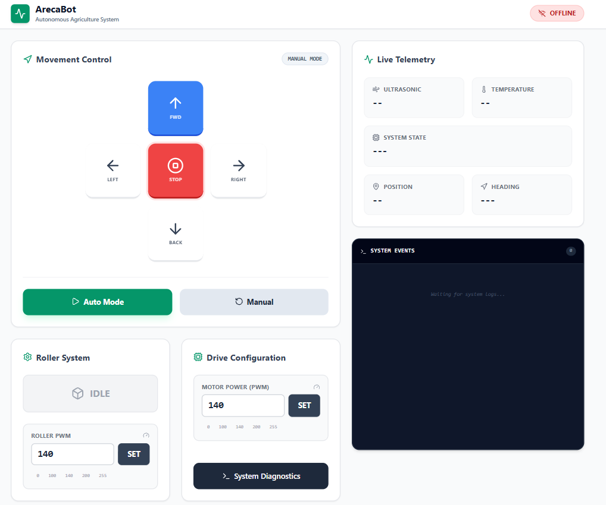

# Samartha H M — Electronics Engineer & IoT Product Developer 🚀⚡

[](https://samartha-hm.github.io/)
[](LICENSE)
[](https://linkedin.com/in/samarthahm)
[](https://github.com/samartha-hm)

> **Electronics engineer and IoT product developer** experienced in embedded firmware, PCB design, 4G/cloud connectivity, and robotics. Applies LLMs and AI coding agents to engineering research, rapid prototyping, and firmware debugging.

---

## 📸 Portfolio Preview

<p align="center">
  <a href="https://samartha-hm.github.io/">
    
  </a>
</p>

*Live Site: [https://samartha-hm.github.io](https://samartha-hm.github.io/)*  
*Resume Source: [`resume.tex`](resume.tex) | Download PDF: [`Samartha_HM_Resume.pdf`](Samartha_HM_Resume.pdf)*

---

## 👨‍💻 About Me

- **Education:** B.E. in Electronics & Communication Engineering — **Srinivas Institute of Technology, Valachil, Mangaluru** (VTU affiliated, CGPA: **7.86 / 10**, Graduated Jun 2026).
- **Core Engineering Competencies:**
  - **Embedded Firmware & Protocols:** Low-level C/C++ firmware, non-blocking finite state machines (IDLE/MANUAL/AUTO_TRAVERSE), PWM/GPIO control, and checksummed serial packet protocols (<50ms latency).
  - **PCB Layout & Circuit Validation:** KiCad/EasyEDA schematic capture, board routing, SMD/through-hole assembly, power electronics, sensor calibration, and oscilloscope/logic analyzer debugging.
  - **IoT & Cellular Telemetry:** 4G/LTE connectivity via SIM7670C modems, MQTT brokers, AWS EC2 cloud pipelines, and sensor multiplexing.
  - **Robotics & Vision:** Autonomous 5-motor 4WD platforms, vertical serpentine path planning, U-Net segmentation (Dice > 0.92), and ResNet-50 classification (98.2% accuracy).
  - **AI-Accelerated Development:** Deep workflow integration with Claude Code CLI, Google Antigravity, local LLMs, and prompt engineering for rapid firmware prototyping and root-cause debugging.

---

## 🏆 Featured Engineering Projects

### 1. [Autonomous Smart Bot for Efficient Sun Drying of Arecanut (ARECAbot)](https://github.com/samartha-hm/ARECAbot) — *Capstone Project (Team Lead)*
- **Problem:** Labor-intensive manual raking and inconsistent sun-drying cause 15–25% post-harvest crop loss for arecanut farmers.
- **Hardware Architecture:** 5-motor 4WD platform (four drive motors + dedicated stirring roller) controlled via three BTS7960 motor drivers (40A peak load).
- **Dual-Controller System:**
  - **Orchestration:** Raspberry Pi 5 hosting a local Wi-Fi AP, FastAPI backend, and React web HMI with Hold-to-Move safety deadman switch.
  - **Real-Time Control:** Arduino Mega running deterministic C++ non-blocking FSM for real-time PWM motor generation.
- **Protocol & Navigation:** Implemented vertical serpentine grid coverage and checksummed 6-byte UART packets achieving **<50ms command latency** with verified boundary handling on field test grids.
- **Offline Vision Pipeline:** Evaluated an offline deep learning vision pipeline using U-Net segmentation and ResNet-50 drying-stage classification (TensorFlow/Keras on 4,000 images); achieved **U-Net Dice coefficient > 0.92** and **ResNet-50 classification accuracy of 96.5% (unpeeled) and 98.2% (peeled)**.

---

### 2. Experimind Labs — *Core Team Member & R&D Lead (Feb 2026 – Present)*
*Promoted from Electronics Intern within 2 months.*
- **Educational IoT Kits:** Shipped two commercial educational hardware kits to **300+ students across 100+ production units** with **98%+ first-pass assembly quality** (Kit 1: 14-component sensor board; Kit 2: multi-experiment robotics platform).
- **Water Quality Monitor v2.0 (Official Product):**
  - Engineered 4G/LTE cellular telemetry using a SIM7670C modem and UART AT commands for an ESP32 multi-parameter monitor (pH, TDS, turbidity, temp, DO).
  - Built MQTT telemetry, FastAPI/WebSocket services, and live AWS EC2 dashboard.
  - **Resolved electrical probe crosstalk between pH and TDS sensors via GPIO-controlled sensor-phase multiplexing.**
- **GravityExplorer (Interactive School Science Exhibit — In Progress):**
  - Offline Windows interactive science exhibit with Electron and Three.js calculating visitor weights across 10 celestial bodies.
  - Built sensor station with Arduino Uno, HX711 load cell, and arcade buttons.
  - Defined 115200-baud newline-delimited JSON serial protocol with sequence numbers, boot IDs, and checksummed EEPROM calibration storage.
- **Land Survey Robot:** Developed Raspberry Pi Pico W firmware integrating GPS, magnetometer, and gyroscope sensor fusion for autonomous waypoint and free-path navigation.

---

### 3. [AI-Powered Smart Waste Segregation](https://github.com/samartha-hm/ispark) — *ISPARK Learning Solutions*
- Built a working prototype in 5 days combining ESP32 sensors/servo control with an ESP32-CAM module.
- Integrated Python MobileNetV2 classifier (**79% accuracy on 600 images**) over UART, achieving sub-second DRY/WET/SKIP sorting and real-time dashboard telemetry.

---

### 4. [Personal Tools & Automation Suite](https://github.com/simply1git) — *Independent Builds*
- **SyncPadIO:** Real-time peer-to-peer text & code sharing web application.
- **WebsiteON:** Serverless website uptime monitor with automated Telegram alerts.
- **SonicSync:** Low-latency WebRTC browser-to-browser audio broadcasting.
- **YotuDrive:** Multi-file YouTube storage engine with Reed-Solomon error-correction encoding.
- **Mobtola Pro:** Python ADB-based automated Android backup utility.

---

## 🛠️ Technical Skills Matrix

| Domain | Technologies & Competencies |
| :--- | :--- |
| **Firmware & Control** | Embedded C, C/C++, Python, Non-Blocking State Machines (FSM), PWM/GPIO, Checksummed Serial Protocols, FreeRTOS |
| **Platforms & Interfaces** | Arduino UNO/Mega, ESP32/ESP32-CAM, Raspberry Pi 5/Pico W, Linux, UART/I2C/SPI, Wi-Fi, MQTT, 4G/LTE (SIM7670C), GPS |
| **AI & Computer Vision** | TensorFlow/Keras, OpenCV, U-Net Segmentation, ResNet-50 Classification, MobileNetV2, CNNs, Transfer Learning |
| **Cloud, Web & Desktop** | AWS EC2, FastAPI, REST, WebSockets/Socket.IO, React, Node.js, TypeScript/JavaScript, Electron, Three.js, SQLite |
| **Electronics & Validation** | KiCad, EasyEDA, LTspice, Schematic/PCB Layout, SMD/Through-Hole Assembly, Multimeter, Oscilloscope, Logic Analyzer, Sensor Calibration, BTS7960 Drivers |
| **AI Development Workflows** | ChatGPT, Claude, Claude Code CLI, Google Antigravity, Local LLMs (Ollama), Hugging Face, Prompt Engineering, AI-Assisted Architecture & Debugging |
| **Developer Tools & Media** | Git/GitHub, VS Code, Jupyter Notebook, PowerShell, Bash, Adobe Premiere Pro, Canva |

---

## 📂 Repository Structure

```text
samartha-hm.github.io/
├── assets/
│   ├── areca-robot.jpg        # Capstone robot hero photo (view 1)
│   ├── areca-2.jpg            # Electronics & wiring view
│   ├── areca-3.jpg            # Chassis assembly & motor drives
│   ├── areca-4.jpg            # Field testing on drying yard
│   ├── areca-5.jpg            # Mechanical roller & frame layout
│   └── webpage.png            # OpenGraph and README preview banner
├── index.html                 # Complete single-page portfolio application
├── resume.tex                 # Latest LaTeX source of professional resume
├── Samartha_HM_Resume.pdf     # Official downloadable developer resume
├── LICENSE                    # MIT Open Source License
└── README.md                  # Comprehensive developer & project documentation
```

---

## 💻 Local Preview

To preview the portfolio locally:

```bash
# Clone the repository
git clone https://github.com/samartha-hm/samartha-hm.github.io.git

# Navigate to directory
cd samartha-hm.github.io

# Open index.html in your default browser
start index.html       # Windows
open index.html        # macOS
xdg-open index.html    # Linux
```

---

## 📬 Contact & Connect

- **Location:** Koppa, Chikkamagaluru, Karnataka, India
- **Email:** [samarth.h.m.gadikal@gmail.com](mailto:samarth.h.m.gadikal@gmail.com)
- **Phone:** +91 8073339032
- **LinkedIn:** [linkedin.com/in/samarthahm](https://linkedin.com/in/samarthahm)
- **GitHub:** [github.com/samartha-hm](https://github.com/samartha-hm)
- **Independent Builds:** [github.com/simply1git](https://github.com/simply1git)

---

## 📄 License

This repository is licensed under the [MIT License](LICENSE).
